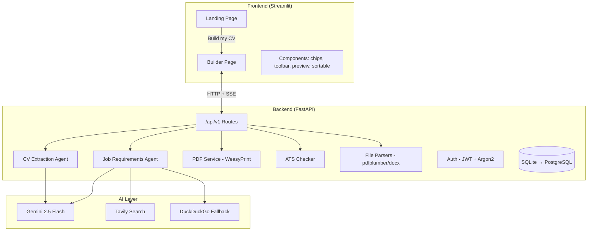

# CVBoost AI — Implementation Plan

## Architecture Overview

---

## Phase 1 — Backend Core + Security

### 1.1 Project Scaffold
- Create directory structure: `cvboost-ai/backend/`, `frontend/`, root configs
- `pyproject.toml` with all pinned dependencies
- `.env.example` with all required keys
- `Makefile` with install/dev/test/lint targets
- Pre-commit config (ruff, bandit)

### 1.2 Configuration & Settings
- `core/config.py` — Pydantic Settings v2, startup validation
- `core/security.py` — JWT, Argon2, cookie helpers
- `core/limits.py` — Rate limiting, quotas

### 1.3 Data Models & Schemas
- Full `CV` Pydantic schema (single source of truth)
- SQLAlchemy models for User, CV, ContactMessage
- Alembic migrations

### 1.4 Auth System
- Email/password registration + login
- Google OAuth (optional)
- JWT access + refresh tokens (httpOnly cookies)
- Anonymous guest mode with signed sessions

### 1.5 Security Middleware
- CORS, HSTS, CSP headers
- Rate limiting (slowapi)
- Request size limits
- SSRF protection utilities

### 1.6 Core Endpoints
- `GET /health`
- `POST /auth/register`, `POST /auth/login`, `POST /auth/refresh`
- `CRUD /cv`
- `POST /contact`

---

## Phase 2 — AI Agents

### 2.1 CV Extraction Agent
- File parsers: pdfplumber, PyMuPDF, python-docx, pytesseract fallback
- LangChain agent with `with_structured_output`
- Prompt injection defense (delimiters, schema validation)
- Confidence scoring per field
- `POST /cv/extract` endpoint

### 2.2 Job Requirements Agent
- Tavily + DuckDuckGo tools
- SSRF-safe `fetch_page` tool
- Skill normalizer tool
- LangGraph orchestration with guardrails
- SSE streaming to frontend
- Result caching (TTL by normalized query)
- `POST /jobs/analyze` endpoint (SSE)

### 2.3 "Improve Bullet" Chain
- Non-agent LangChain chain
- Diff output (before/after)
- `POST /cv/improve-bullet` endpoint

---

## Phase 3 — PDF Service + ATS Checker

### 3.1 Jinja2 PDF Templates
- Template 1: Reference layout (sidebar left, `#09637E`, timeline)
- Template 2: Single-column classic
- Template 3: Minimal
- Style variables driven by toolbar settings
- Language support (EN/FR/AR + RTL)

### 3.2 WeasyPrint Renderer
- Custom url_fetcher (local assets only, no external SSRF)
- Page break logic (no split entries)
- Embedded fonts
- Tagged PDF with metadata

### 3.3 ATS Compliance Validator
- PyMuPDF/pdfplumber text extraction
- Section detection (regex per language)
- Contact parsing (email, phone)
- Skills list verification
- Reading order check
- ATS score + issue list
- `POST /cv/ats-check` endpoint

### 3.4 PDF endpoint
- `POST /cv/pdf` — generate and stream PDF

---

## Phase 4 — Streamlit Builder

### 4.1 State Management
- `st.session_state` as single source of truth for CV schema
- Auto-save to backend on change (debounced)

### 4.2 Job Target Component
- Textarea with 1.2s debounce
- SSE consumer showing progress
- Chips panel (skills grouped by category, languages)
- Source links + tooltips

### 4.3 Import Block
- Drag-and-drop file upload (PDF/DOCX)
- LinkedIn PDF import
- Progress + extraction result review

### 4.4 Personal Details Form
- All fields with optional add-ons (chips)
- Photo upload + circle crop

### 4.5 CV Sections (Accordion)
- Drag-and-drop reorder (`streamlit-sortables`)
- Education, Projects, Skills, Languages editors
- "Improve with AI" per bullet (diff view)
- ⋮ context menus

### 4.6 Bottom Toolbar
- Templates, Font, Spacing, Layout, Colours
- Fullscreen + zoom
- Download PDF, Save draft, Export JSON

### 4.7 Live Preview
- Iframe rendering FastAPI PDF preview endpoint
- Debounced refresh on CV change

---

## Phase 5 — Landing Page

### 5.1 Streamlit Landing Page
- Full-page HTML via `st.components.v1.html`
- Tailwind CDN with custom palette
- Header, Hero, Feature cards, How it works, Contact form
- Animations (AOS or CSS keyframes)
- Contact form → `POST /api/v1/contact`

---

## Phase 6 — Tests + Docker

### 6.1 Tests
- Unit: parsers, schema, ATS checker, normalizer
- Integration: all endpoints, upload hardening, SSRF, auth, rate limits
- Agent tests: mocked Gemini + Tavily
- Golden test: reference CV extraction > 95% accuracy
- PDF ATS validation test

### 6.2 Docker
- `Dockerfile.backend` (Python 3.11, non-root user)
- `Dockerfile.frontend` (Streamlit)
- `docker-compose.yml` (backend, frontend, optional redis)
- Health checks

### 6.3 Final Docs
- `README.md` with architecture, setup, env vars, screenshots
- `SECURITY.md` with OWASP Top 10 + OWASP LLM Top 10 mapping

---

## Dependency Versions (pinned)

| Package | Version |
|---|---|
| fastapi | 0.115.* |
| uvicorn | 0.30.* |
| pydantic | 2.7.* |
| sqlalchemy | 2.0.* |
| alembic | 1.13.* |
| langchain | 0.3.* |
| langchain-google-genai | 2.0.* |
| langchain-community | 0.3.* |
| langgraph | 0.2.* |
| google-generativeai | 0.8.* |
| tavily-python | 0.5.* |
| weasyprint | 62.* |
| jinja2 | 3.1.* |
| pdfplumber | 0.11.* |
| PyMuPDF | 1.24.* |
| python-docx | 1.1.* |
| pytesseract | 0.3.* |
| passlib[argon2] | 1.7.* |
| python-jose | 3.3.* |
| slowapi | 0.1.* |
| streamlit | 1.37.* |
| streamlit-sortables | 0.2.* |
| bleach | 6.1.* |
| httpx | 0.27.* |
| pillow | 10.* |
| ruff | 0.5.* |
| pytest | 8.* |
| pytest-asyncio | 0.23.* |
| bandit | 1.7.* |

---

## Execution Order

1. ✅ Architecture & Implementation Plan
2. ✅ Phase 1: Backend scaffold + security + auth + DB + core endpoints
3. ✅ Phase 2: AI agents (extraction agent + job requirements agent + improve bullet)
4. ✅ Phase 3: PDF templates + WeasyPrint renderer + ATS compliance checker
5. ✅ Phase 4: Streamlit builder UI (state, live preview, chips, toolbar, ATS score display)
6. ✅ Phase 5: Landing page (modern Tailwind design, features, interactive contact form)
7. ✅ Phase 6: Tests + Docker + README + SECURITY.md
